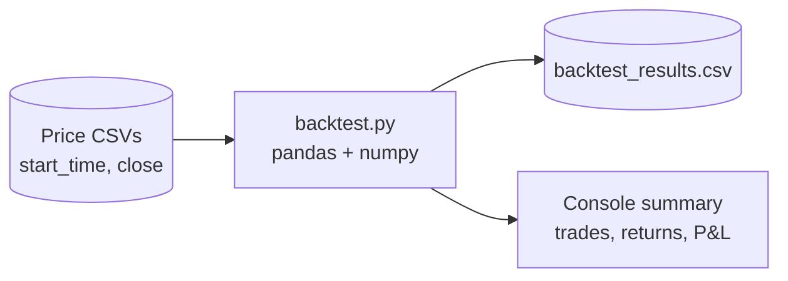

# Gold Crossover Backtest: High-Level Design

Backtests a 5 / 20-period simple moving average (SMA) crossover strategy on gold price data, avoiding lookahead bias, and reports returns and profit. For code-level detail see the [Low-Level Design](lld.md).

## 1. Context

## 2. Strategy

| Rule | Value |
|---|---|
| Short SMA | 5 periods of `close` |
| Long SMA | 20 periods of `close` |
| Signal | Long (1) when short SMA > long SMA, otherwise flat (0) |
| Execution | Act on the next bar: position = signal shifted by one (no lookahead) |
| Trade size | 100 USD notional for P&L |

## 3. Tech

| Item | Choice |
|---|---|
| Language | Python 3 |
| Libraries | pandas, numpy |
| Data | Every `*.csv` in the script folder (e.g. `15_June_months.csv`, `30_June_months.csv`), combined and sorted by time |
