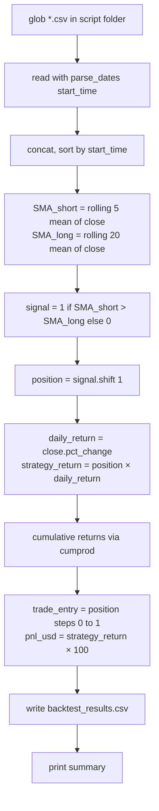

# Gold Crossover Backtest: Low-Level Design

For the big picture see the [High-Level Design](hld.md).

## 1. Pipeline

## 2. Output columns

| Column | Meaning |
|---|---|
| `start_time`, `close` | Bar time and closing price |
| `SMA_short`, `SMA_long` | 5 and 20-period averages |
| `signal` | 1 long / 0 flat, computed on this bar |
| `position` | Signal from the previous bar (what is actually held) |
| `daily_return` | Bar-to-bar change in `close` |
| `strategy_return` | `position × daily_return` |
| `cum_asset_return`, `cum_strategy_return` | Compounded buy-and-hold vs strategy return |
| `trade_entry` | 1 on bars where a long position opens |
| `pnl_usd` | Profit for this bar on a 100 USD position |

## 3. Summary metrics

| Metric | Formula |
|---|---|
| Trades | Sum of `trade_entry` |
| Asset return % | Last `cum_asset_return` × 100 |
| Strategy return % | Last `cum_strategy_return` × 100 |
| Total profit (USD) | Sum of `pnl_usd` |

## 4. Errors

If no CSV is found next to the script, it stops with `FileNotFoundError`.
